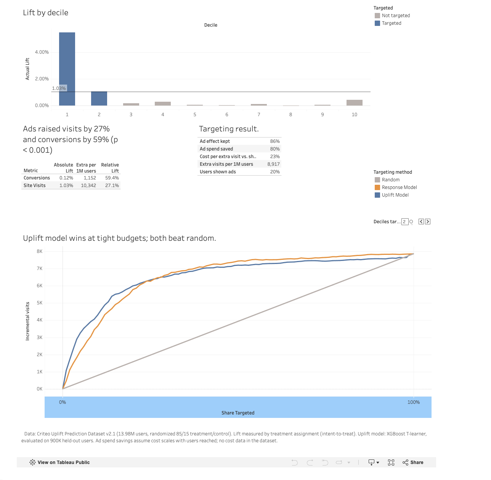

# Who should Criteo show ads to? Causal lift and uplift modeling on a 14M-user experiment

**[Interactive dashboard on Tableau Public](https://public.tableau.com/app/profile/anushka.mote/viz/CriteoUpliftAnalysis/WhoshouldCriteoshowadstoUpliftanalysisofa14M-userexperiment)**

## Business question
Do Criteo's ads cause more site visits and conversions, and if so, which users should the ad budget go to?

## Key results
- **Ads work.** Visits rose 27.1% (95% CI: 26.2% to 28.0%) and conversions rose 59.4% (95% CI: 54.4% to 64.7%), both p < 0.001.
- **The effect is concentrated.** The top 10% of users by predicted uplift showed a 5.5 pt visit lift, 5x the average. Deciles 3 to 9 showed effectively none.
- **Targeting the top 20% keeps 86% of the ad effect at 20% of the spend**, making each extra visit about 77% cheaper than showing ads to everyone.

## Recommendation
Target the top 20% of users by predicted uplift. Per 1M users, this shows ads to 200,000 people instead of 1,000,000 while keeping about 8,900 of the ~10,340 incremental visits. Going to 30% adds only 2 points of effect for 50% more spend.

## Data
[Criteo Uplift Prediction Dataset v2.1](https://ailab.criteo.com/criteo-uplift-prediction-dataset/): 13,979,592 users randomly split 85/15 into treatment (eligible for ads) and control (held out). Includes 12 anonymized features, visit and conversion outcomes, and an exposure flag. Released by Criteo AI Lab for non-commercial research (Diemert et al., AdKDD 2018).

## Method
| Step | What I did | Tools |
|---|---|---|
| Load | Staged and loaded the 297 MB file into Snowflake | Snowflake, SQL, Snowflake CLI |
| Validate | Data quality checks; sample ratio mismatch test (χ² p ≈ 0.999); covariate balance (max \|SMD\| = 0.049) | SQL, scipy |
| Measure lift | Two-proportion z-tests and 95% CIs on visits and conversions, by treatment assignment (intent-to-treat) | statsmodels |
| Power | Minimum detectable effect and required sample size at 80% power | statsmodels |
| Model uplift | T-learner with two XGBoost classifiers; evaluated on 900K held-out users with Qini curves | XGBoost, scikit-learn |
| Target | Measured actual lift by uplift decile; built budget scenarios | pandas |
| Present | Interactive dashboard with a targeting slider | Tableau Public |

## Findings in more detail
- **Experiment integrity:** No invalid values, no missing data, no conversions without a visit, and no exposed control users. The 85/15 split matched the design almost exactly, and all 12 features were balanced.
- **Power:** The overall effect was large relative to noise. Detecting the visit lift needed only about 24,000 users. The 14M scale matters for segment-level analysis, where each slice is much smaller.
- **Uplift vs. a standard response model:** The uplift model wins at tight budgets (top 10%: 72% vs. 65% of the effect kept). Beyond 20%, both perform similarly, meaning users most likely to visit are largely the same users ads persuade in this data.

## Limitations
- No cost data, so savings are expressed as share of impressions cut, assuming cost scales with users reached.
- Features are anonymized, so segments can't be described in business terms (e.g. age or device).
- Lift is intent-to-treat. Not every treated user saw an ad, so the effect on users who actually saw one is larger.
- The public dataset combines several Criteo experiments, so segment-level estimates may carry some cross-experiment variation.
- The uplift model was trained on a 3M-user sample and models visits only; conversions were too rare for a stable individual-level model.

## Repository structure
sql/          Snowflake load, quality checks, SRM, and lift aggregation
notebooks/    Lift statistics, power analysis, uplift model, targeting analysis
data/         Summary outputs used by the dashboard (raw data not included)
notes.md      Detailed analysis notes for every step

## How to reproduce
1. Download `criteo-research-uplift-v2.1.csv.gz` into `data/`.
2. Run the SQL files in `sql/` in order in Snowflake (uploading the file to the stage with the Snowflake CLI).
3. Run the notebooks in `notebooks/` in order. They connect to Snowflake through a named CLI connection.